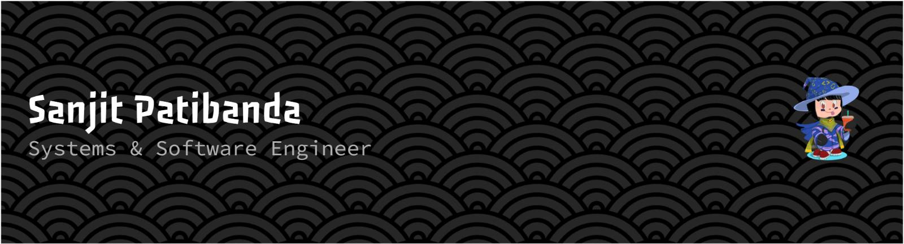
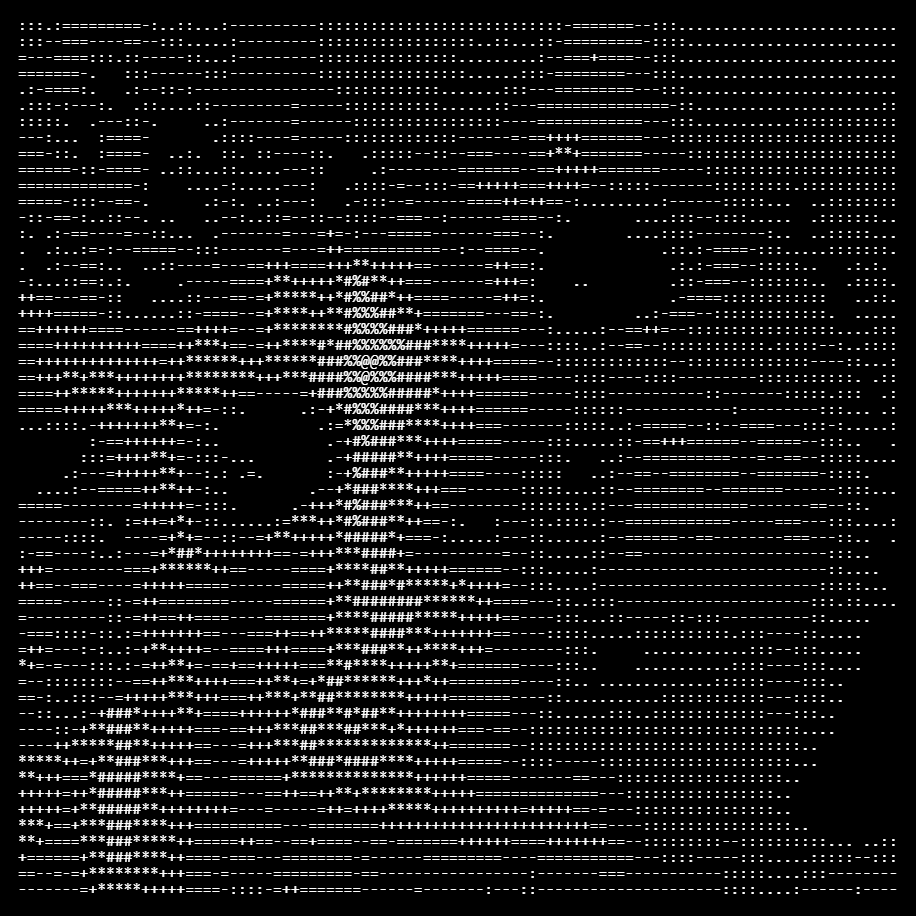

  

  <h3>✧ AI Research, Robotics &amp; Developer Infrastructure ✧</h3>

  

 

  

 

# ✧ About Me

 

  
  

    <b>I build backend systems, software infrastructure, and intelligent tools</b>, with a focus on orchestration, reverse engineering, and automation.
      
    My interests span <b>distributed systems, systems programming, information retrieval, agent architectures</b>, and computational tooling. I enjoy understanding how things work under the hood and building across different layers of abstraction.
      
    I am interested in tools that expand how people process information, explore ideas, and turn imagination into working systems.
  

 

 

  

 

# ✧ Tech Stack &amp; Infrastructure

 

### Languages &amp; Core Systems

 

### Frameworks, Databases &amp; Infrastructure

 

### AI, Machine Learning, Agent Tooling &amp; Robotics

 

  

 

# ✧ Contribution Metrics

 

<!-- cool-readme:start -->
<!-- Cards by github-cool-readme: https://github.com/pedrocatalao/github-cool-readme -->

<picture>
  <source media="(prefers-color-scheme: dark)" srcset="https://raw.githubusercontent.com/Sneakyboss221/Sneakyboss221/cards/summary-dark.svg">
  
</picture>
<picture>
  <source media="(prefers-color-scheme: dark)" srcset="https://raw.githubusercontent.com/Sneakyboss221/Sneakyboss221/cards/languages-dark.svg">
  
</picture>

<picture>
  <source media="(prefers-color-scheme: dark)" srcset="https://raw.githubusercontent.com/Sneakyboss221/Sneakyboss221/cards/weekly-dark.svg">
  
</picture>
<picture>
  <source media="(prefers-color-scheme: dark)" srcset="https://raw.githubusercontent.com/Sneakyboss221/Sneakyboss221/cards/streaks-dark.svg">
  
</picture>

<!-- cool-readme:end -->
